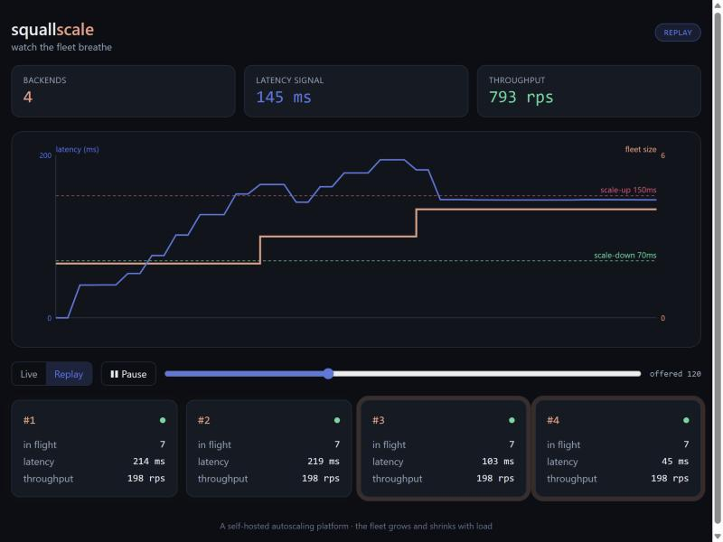

<div align="center">

# squallscale

### A self-hosted autoscaling platform you can watch breathe.

A fleet of small C++ backends behind an nginx load balancer. A controller watches their load and
adds or removes backends as traffic rises and falls — rewriting the load balancer live, with no
dropped requests — and a dashboard animates the fleet scaling up and down in real time.

[](https://github.com/ManvGit17/squall-scale/actions/workflows/ci.yml)
[](https://github.com/ManvGit17/squall-scale/releases)




</div>

## Why this exists

Autoscaling, load balancing, health checks and zero-downtime config reloads are the core of cloud
computing, but they usually live behind a managed service where you can't see them work. squallscale
builds them from the ground up — a raw C++ socket server, nginx, a controller and a pipeline — and
then makes them **visible**: the dashboard shows each backend appear and vanish, requests flowing to
them, and latency driving the fleet's size against the scaling watermarks.

It grows from a five-file starting point — the C++ server, two replicas behind nginx, and a Jenkins
pipeline — which remain the repository's first commits.

## What's inside

| Piece | What it does |
| :-- | :-- |
| **Backend** (C++17) | A dependency-light HTTP server on a thread pool. Reports load on a Prometheus `/metrics` endpoint and liveness on `/healthz`; drains in-flight requests on shutdown. |
| **Load balancer** (nginx) | Spreads traffic across the fleet. Its upstream is rewritten and hot-reloaded as backends come and go, with no dropped requests. |
| **Controller** (Python) | Scrapes each backend's latency, decides scale up/down with watermarks and cooldowns, starts and drains backend containers, and rewrites nginx. Serves the live fleet state on `/state`. |
| **Dashboard** (React) | Animates the fleet breathing: cards appear and vanish, pulse with request flow, and a chart plots latency against fleet size. Works live, or replays a recorded run. |
| **Load generator** (Python) | Drives traffic with `steady`, `spike` and `ramp` presets. |

## Quick start

Requires Docker with the Compose plugin.

```bash
docker compose up --build
```

- Dashboard → <http://localhost:8090>
- Load balancer → <http://localhost:8088>
- Controller API → <http://localhost:8089/state>

Drive some load and watch the dashboard grow and shrink the fleet:

```bash
python loadgen/loadgen.py ramp --start 2 --end 100 --duration 60
```

Tear it down (including backends the controller spawned):

```bash
bash scripts/down.sh
```

## Measured, not claimed

Every number here comes from a script you can rerun.

- **Thread-pool throughput** — one worker (serialized, like the original blocking loop) reaches
  ~25 rps; eight and sixteen workers scale it to ~198 and ~398 rps.
  → [`bench/benchmark.py`](bench/benchmark.py), [results](bench/results/throughput.md)
- **A full scale cycle** — under a ramp to 120 concurrent clients the fleet grows 2 → 4 backends,
  throughput rises from ~400 to ~795 rps, latency settles near the watermark, then it drains back to
  2 when the load stops.
  → [`scripts/scale_run.py`](scripts/scale_run.py), [write-up](docs/elasticity.md)

## How it's built

```
load gen → nginx (:8088) → backend ··· backend     C++ /metrics /healthz
                 ▲              │
                 │ rewrite +    │ scrape latency
                 │ reload       ▼
            controller (:8089) ── docker API ── start/stop backends
                 │ SSEless /state
                 ▼
            dashboard (:8090)
```

- [Architecture](docs/architecture.md) — the pieces and how they fit.
- [Elasticity](docs/elasticity.md) — how the autoscaler decides, with a measured run.
- [Operations](docs/operations.md) — running, tuning and troubleshooting.
- [Roadmap](docs/roadmap.md) — what's next.

## Tests and CI

```bash
docker build --target test backend          # C++ unit tests
cd controller && python -m pytest tests      # controller unit tests
cd dashboard && npm ci && npm test           # dashboard unit test
bash scripts/smoke.sh                         # end-to-end against a running fleet
```

GitHub Actions runs all of these plus an end-to-end job that brings the fleet up and checks the
controller reports a healthy minimum. A Jenkins pipeline ([`Jenkinsfile`](Jenkinsfile)) builds and
smoke-tests the fleet too.

## Contributing

Issues and pull requests are welcome — see [CONTRIBUTING.md](CONTRIBUTING.md) and the
[good first issues](docs/good-first-issues.md).

## License

[Apache-2.0](LICENSE).
