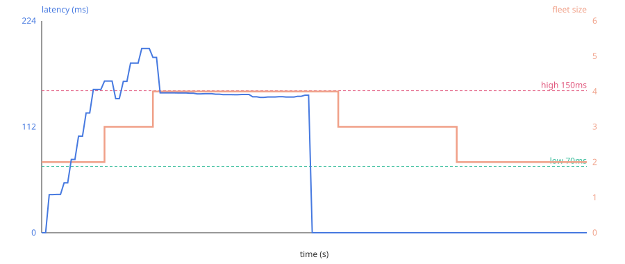

# Elasticity: the autoscaler

The controller watches the fleet and changes its size to match load. This page
explains how, and shows a measured run with the real numbers behind the claim.

## How it decides

Every two seconds the controller scrapes each backend's `/metrics` and derives
the **recent average request latency** — the time from a request being accepted
to its response, so it includes any wait in the backend's queue. Queue wait is
what climbs when a backend is saturated, which makes latency a clear,
non-saturating scaling signal (unlike in-flight count, which is capped by the
thread-pool size).

The decision itself is a pure function ([`controller/scaling.py`](../controller/scaling.py)),
unit-tested without Docker:

- **Scale up** when the average latency is at or above the high watermark, the
  fleet is below its maximum, and the up-cooldown has elapsed.
- **Scale down** when latency is at or below the low watermark (or the fleet is
  idle), it is above its minimum, and the longer down-cooldown has elapsed.
- Minimum and maximum fleet size bound everything; separate cooldowns stop it
  flapping.

Adding a backend is **health-gated**: the controller starts the container,
waits for its `/healthz` to pass, *then* adds it to the nginx upstream and
reloads. Removing one is **drained**: the controller first rewrites the upstream
without it and reloads (so nginx stops routing to it), waits out a drain window,
and only then stops the container — which itself finishes any in-flight request
before exiting. No request is dropped on either path.

Defaults (all overridable by environment variable):

| Setting | Value |
| :-- | :-- |
| Min / max backends | 2 / 6 |
| High / low watermark | 150 ms / 70 ms |
| Up / down cooldown | 10 s / 25 s |
| Scrape interval | 2 s |
| Drain window | 5 s |

## A measured run

Reproduce it with the stack up (`docker compose up --build`):

```bash
python scripts/scale_run.py --peak 120 --ramp 25 --hold 45 --idle 80
```

It ramps offered concurrency from 2 to 120 over 25 s, holds for 45 s, then goes
idle for 80 s, polling the controller once a second. The recorded data is in
[`bench/results/scaling-run.csv`](../bench/results/scaling-run.csv); the summary
in [`scaling-run.json`](../bench/results/scaling-run.json).



What happened, from the recording:

| Phase | Time | Offered | Fleet | Latency | Throughput |
| :-- | :-- | --: | --: | --: | --: |
| Start, idle | 0 s | 2 | 2 | 0 ms | 0 rps |
| Ramp, 2 backends saturate | 10 s | 50 | 2 | 102 ms | ~400 rps |
| Latency crosses 150 ms → scale up | 17 s | ~80 | 2→3 | 151 ms | — |
| 3 backends, still hot → scale up | 30 s | 120 | 3→4 | 185 ms | ~600 rps |
| 4 backends, latency settles | 35–70 s | 120 | 4 | ~146 ms | ~795 rps |
| Load stops, fleet drains down | 77–118 s | 0 | 4→3→2 | 0 ms | 0 rps |

The honest read:

- Two backends (16 worker threads) cap out near **400 rps** and latency rises to
  the watermark. The autoscaler adds backends until latency falls back under it,
  settling at **4 backends** doing **~795 rps** — throughput roughly doubled by
  adding capacity, and it stopped there rather than over-provisioning.
- Peak latency reached **195 ms** briefly, between a watermark breach and the new
  backend coming online — the cost of reacting rather than predicting.
- When the load stopped, the fleet drained back to the minimum of 2 over the
  down-cooldowns. Scale-down is deliberately slower than scale-up.

### What this run is and isn't

- The backend does a fixed **40 ms of simulated work** per request (`WORK_MS`),
  so "load" is controllable and repeatable; it is not a real workload.
- The latency is end-to-end service time on the backend (queue + work), measured
  by the backend itself, not wall-clock latency seen by the client.
- The load generator is a single Python process (closed-loop concurrency); at
  very high rates it, rather than the fleet, could become the limit. The numbers
  above are from one machine and will differ on yours — which is why the script
  is here to rerun.
